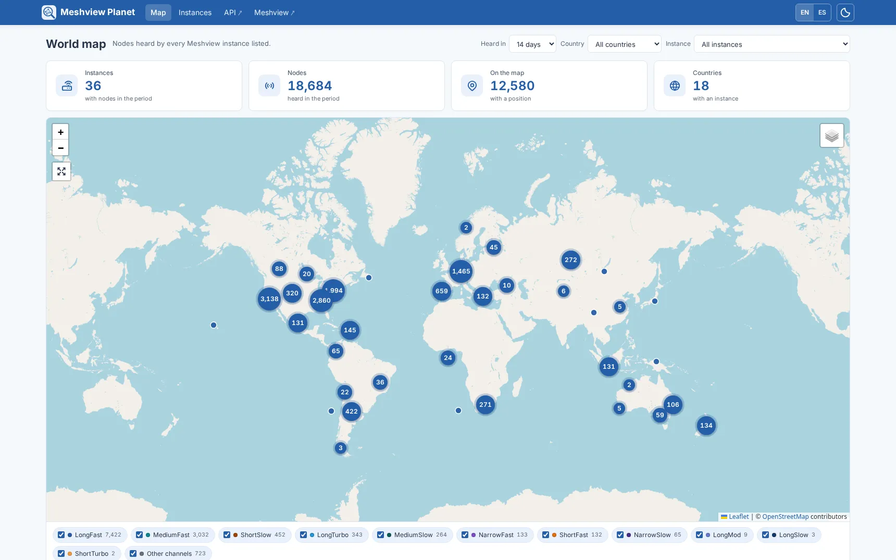

<div align="center">


# Meshview Planet

**A world map of the nodes every [Meshview](https://github.com/meshview/meshview) instance sees**

*Every listed instance's nodes on one map, and the instances themselves, day by day.*

[](https://github.com/meshview/planet/actions/workflows/ci.yml)
[](https://github.com/meshview/planet/releases/latest)
[](LICENSE)
<br>
[](#running-it)
[](docs/configuration.md#database)
[](docs/development.md#translations)
[](https://github.com/meshview/planet/pkgs/container/planet)

[Documentation](docs/README.md) · [Running it](#running-it) · [API](docs/api.md) · [Meshview](https://github.com/meshview/meshview) · [Meshview's website](https://meshview.github.io/)



</div>

---

A small application in Meshview's style, to deploy wherever you want: it
gathers the nodes of the Meshview instances on its list on one map of the world.

Every few hours it asks each listed instance for its version and the nodes it
heard, keeps what each answered in SQLite, and counts its nodes day by day. An
instance that stops answering goes offline after three days, which takes its
nodes off the map, and is deleted after thirty more; one that answers again
comes back by itself.

Anyone can add an instance from the site, with no moderation: it is accepted
only if it answers as a Meshview there and then, and its area is chosen from a
closed list of countries and their regions (ISO 3166), so nothing typed by a
visitor is ever shown as text. The administrator can be told of each one, and
of instances going offline, coming back or being deleted, by a webhook, ntfy,
Discord, Slack, Matrix or Telegram.

The site is in English and Spanish, in light and dark, and its API is
documented at `/api/docs`.

## Running it

From a release's static binary, or a build:

```sh
cargo build --release
./target/release/meshview-planet   # serve on :8080 and collect
```

Or the container image:

```sh
podman run -d -p 8080:8080 -v planet-data:/data ghcr.io/meshview/planet:latest
```

The configuration is `config.toml` (see [sample.config.toml](sample.config.toml))
or environment variables, `MESHVIEW_PLANET_<SECTION>__<KEY>`.

## Documentation

- [Configuration](docs/configuration.md)
- [Deployment](docs/deployment.md)
- [API](docs/api.md)
- [Development](docs/development.md)

## License

AGPL-3.0-or-later, as Meshview. The list of areas comes from Debian's
iso-codes (LGPL-2.1-or-later), and the bundled libraries keep their own
licenses, beside them under `assets/static/vendor/`.
